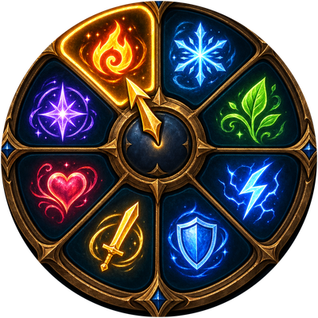

# Radial Bars



Radial action bars for World of Warcraft: Forever.

Turns one action bar (2-8) into a circular wheel, opened by a hotkey at screen
center or at the mouse cursor. The original Blizzard bar stays visible; Action Bar 1 is not touched.

## Use

Open Options > AddOns > Radial Bars, or `/radialbars`. Every setting below is
saved per bar.

**Behavior**

- **Action bar:** which bar (2-8) the wheel shows.
- **Hotkey behavior:**
  - **Toggle:** press the hotkey to open, click a slot to use it. The wheel
    closes after use; the center **Cancel**, the hotkey again, or Esc closes it.
  - **Hold:** hold the hotkey and push the mouse toward a slot; it highlights
    and its name shows in the center. Release to use it. Releasing in the
    center **Cancel** zone uses nothing. The cursor is hidden while held and a
    pointer shows the direction (option: **Hide cursor in Hold mode**).
- **Open at:** screen center, the mouse cursor, or a fixed position. For a
  fixed position, click **Preview wheel** and drag the wheel into place.
- **Hotkey:** click, then press a key with optional Alt, Ctrl, Shift. It
  overrides any game binding on that key while Radial Bars is loaded.

**Appearance**

- **Icon shape:** Square (default, Blizzard action button border), Circle, or
  Radial slice (pie wedges; the whole wedge is clickable).
- **Sliders:** buttons shown (first 4-12 of the bar), icon size, spacing
  (distance from center), margin (backdrop around icons), center size (dead
  zone and slice hub), slice gap, backdrop opacity (0 hides it), icon opacity.
- **Show description in center:** the selected ability's name always shows in
  the center; its description shows too when the center is at least about 100
  pixels wide (raise **Center size** or **Spacing**).
- **Preview wheel** shows changes live.

Works in combat. Settings changed in combat apply when combat ends.

Options > AddOns > Radial Bars > **Changelog** lists what changed in each
version.

## Develop

Symlink this repository into the Forever AddOns folder (macOS):

```sh
ln -s ~/git/_opensource/jdylanmc/forever-radial-bars \
  "/Applications/World of Warcraft/_forever_/Interface/AddOns/RadialBars"
```

The link must be named `RadialBars` to match `RadialBars.toc`. `/reload` in
game picks up new files and changes; renaming or deleting the TOC needs a
client restart.

See [AGENTS.md](AGENTS.md) for the file layout, client rules (combat
lockdown, secret values), and checks.

```sh
npm ci
luacheck .
busted
npm run test:scripts
npm run changelog:check
```

## Planned

More than one wheel at a time.

## Release

Releases are automated with [Changesets](https://github.com/changesets/changesets):

1. Each pull request adds a changeset (`npx changeset`) describing the change
   for players. CI requires one.
2. Merging to `main` opens or updates a **Version Packages** pull request that
   bumps the version and writes `CHANGELOG.md` and `Changelog.lua`.
3. Merging that pull request tags `v<version>` and runs the
   [BigWigs packager](https://github.com/BigWigsMods/packager), which publishes
   a GitHub release and uploads to CurseForge.

If packaging fails after the tag is pushed, re-run the **Release** workflow on
`main`. It packages an existing `v<version>` tag that has no GitHub release.
It also retries a release without an uploaded, nonempty ZIP asset; release
metadata alone does not mean packaging finished. The packager creates or
updates the GitHub release before uploading its ZIP. A re-run may upload the
same version to CurseForge again.

CurseForge upload needs the `CF_API_TOKEN` repository secret and
`## X-Curse-Project-ID` in `RadialBars.toc`.

## License

MIT. See [LICENSE](LICENSE).
